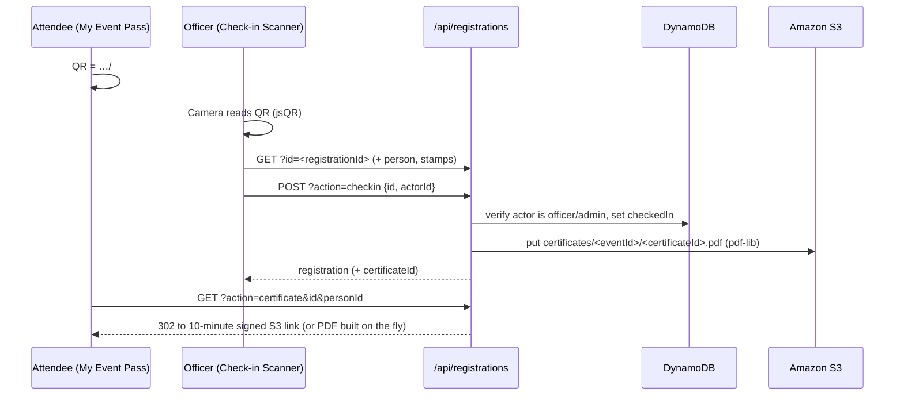
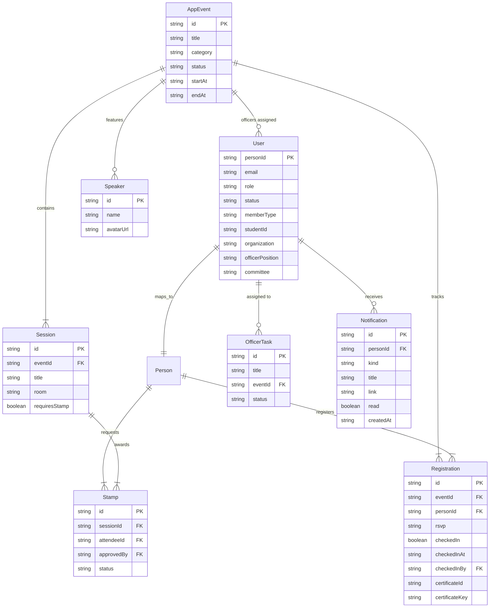

# AWS SBG-APC Event Tracker — System Architecture 📐

This document describes the architectural layout, data flow, component hierarchies, and design principles of the **AWS SBG-APC Event Tracker** application.

---

## 🏗️ High-Level System Architecture

```mermaid
graph TD
    User["📱💻 User (Attendee / Officer / Admin)"] --> Layout["AppLayout (Sidebar on laptops, Bottom Nav on phones)"]
    
    subgraph Presentation Layer
        Layout --> Dashboard["DashboardPage"]
        Layout --> Flow["EventFlowPage"]
        Layout --> Profile["ProfilePage"]
        Layout --> OfficerDash["OfficerDashboardPage"]
        OfficerDash --> Scanner["OfficerScanPage (camera QR check-in)"]
        Layout --> Pass["EventPassPage (QR pass, calendar, certificate)"]
        Layout --> Notifs["NotificationsPage (bell inbox)"]
        Layout --> Leader["LeaderboardPage (ranking & badges)"]
        Public["VerifyCertificatePage (public /verify/:id)"]
        Layout --> AdminHome["AdminHome (admin /home)"]
        AdminHome --> AdminDash["AdminDashboardPage (Manage Accounts)"]
        AdminHome --> AdminAtt["AdminAttendeesPage (Attendees & Stamps, Excel)"]
        AdminHome --> AdminOff["AdminOfficersPage (Officers, Archive)"]
        AdminHome --> AdminTasks["AdminTasksPage (Officer Tasks)"]
        Layout --> Builder["EventBuilderPage"]

        Dashboard --> StampCard["EventStampCard (Circle Stamp Passport)"]
        Flow --> StampCard
        Profile --> QRCard["NetworkingCard (Inline QR Code)"]
        Profile --> AvatarAdjuster["AvatarImageAdjuster (Circular Crop)"]
        Builder --> BannerAdjuster["ImageBannerAdjuster (16:9 Frame)"]
        Builder --> AvatarAdjuster
        Builder --> UploadShelf["RecentUploadsShelf (Recent Uploads Storage)"]
    end

    subgraph State Management Layer
        AuthCtx["AuthContext (User Session & Role)"]
        EventCtx["EventContext (Active Event Selection)"]
    end

    subgraph Client Service Layer
        AuthSvc["authService.ts"]
        EventSvc["eventService.ts"]
        SessionSvc["sessionService.ts"]
        StorageSvc["storageService.ts"]
        UploadStorageSvc["uploadStorageService.ts"]
        RegSvc["registrationService.ts"]
        TaskSvc["taskService.ts"]
        NotifySvc["notifyService.ts (emails)"]
        InAppSvc["notificationService.ts (bell)"]
        IDBStore[("Browser IndexedDB (Persistent File Storage)")]
        LocalStore[("Browser LocalStorage (Fallback)")]
    end

    subgraph Serverless API & AWS Cloud
        VercelAPI["Vercel Serverless Functions (/api/*)"]
        DynamoDB[("Amazon DynamoDB (single table: users, events, sessions, stamps, registrations, tasks, speakers, notifications, uploads)")]
        S3Bucket[("Amazon S3 (banners, avatars, certificate PDFs)")]
        SES[("Gmail SMTP / Amazon SES (Emails)")]
        Cron["Vercel Cron (daily 8:00 AM Manila)"]
    end

    Dashboard -.-> AuthCtx
    Dashboard -.-> EventCtx
    OfficerDash -.-> SessionSvc
    StampCard -.-> SessionSvc
    BannerAdjuster -.-> StorageSvc
    AvatarAdjuster -.-> StorageSvc

    EventSvc --> VercelAPI
    SessionSvc --> VercelAPI
    StorageSvc --> VercelAPI
    EventSvc -.-> LocalStore
    SessionSvc -.-> LocalStore
    AuthSvc --> VercelAPI
    AuthSvc -.-> LocalStore
    RegSvc --> VercelAPI
    TaskSvc --> VercelAPI
    NotifySvc --> VercelAPI
    InAppSvc --> VercelAPI
    InAppSvc -.-> LocalStore
    Scanner -.-> RegSvc
    Pass -.-> RegSvc
    Notifs -.-> InAppSvc
    Scanner -.-> SessionSvc
    Leader -.-> SessionSvc
    Public -.-> RegSvc
    AdminAtt -.-> RegSvc
    AdminTasks -.-> TaskSvc
    Cron --> VercelAPI
    VercelAPI --> SES

    VercelAPI --> DynamoDB
    VercelAPI -. Pre-signed URLs .-> S3Bucket
```

---

## 🧩 Architectural Layers

### 1. Presentation & Component Layer
- **`AppLayout.tsx`**: Main structural layout wrapper implementing:
  - Sticky mobile `AppBar` (`position="sticky"`, `borderRadius: 0`) with title truncation.
  - Inline collapsible menu (`Collapse`) for mobile navigation without backdrop overlays.
  - Laptop permanent sidebar `Drawer` from the `md` breakpoint (768px; set in `theme.ts`).
  - Fixed `BottomNav` bar on phones (below 768px).
  - Page content centered with `maxWidth: 1280`.
- **Admin pages** (`AdminHome`, `AdminDashboardPage`, `AdminAttendeesPage`, `AdminOfficersPage`, `AdminTasksPage`) share `AdminUi.tsx` (header with back link, stat tiles, empty states, date formatting).
- **`EventStampCard.tsx`**: Self-contained component that computes event session stamp slots dynamically:
  - Reads active event sessions and attendee stamp status.
  - Renders grid of circular slots representing each workshop/session.
  - Handles one-tap stamp requests and displays approval state transitions (`approved`, `pending`, `unclaimed`).
- **`ImageBannerAdjuster.tsx`**: 16:9 interactive banner frame editor with zoom, pan, and 1280×720 export matching preview.
- **`AvatarImageAdjuster.tsx`**: Circular avatar cropper with circular mask preview and pan/zoom controls for attendees and speakers.
- **`NetworkingCard.tsx`**: Inline, non-overlay profile card generating external QR code images using QR Server API.

### 2. State Management Layer
- **`AuthContext.tsx`**:
  - Manages active user session (`User | null`).
  - Handles `login`, `logout` and `setCurrentUser` (after profile changes).
  - Persists the signed-in user in `localStorage` under `aws-event-tracker.user` and refreshes it from the server on startup (so role changes and approvals apply).
- **`EventContext.tsx`**:
  - Maintains currently selected active event (`AppEvent | null`).
  - Persists event context in `localStorage` under `aws-event-tracker.selectedEvent` and refreshes it on startup.

### 3. Service, Serverless & Cloud Storage Layer
- **`sessionService.ts`**: Handles session lookup, stamp creation (`createStamp`), stamp approvals (`approveStamp`), and declines (`declineStamp`). Connects to `/api/stamps` and `/api/sessions` with local fallback.
- **`eventService.ts`**: Handles event CRUD operations, connecting to `/api/events` with local fallback.
- **`storageService.ts`**: Requests S3 pre-signed upload URLs from `/api/upload-url` and streams cropped images directly to Amazon S3.
- **`api/` (Vercel Functions)**: Self-contained serverless microservices connecting to AWS SDK v3 DynamoDB client (`@aws-sdk/client-dynamodb`, `@aws-sdk/lib-dynamodb`) and S3 client (`@aws-sdk/client-s3`).
- **`authService.ts`**: Sign up, sign in, approval (`approveUser` / `rejectUser`), profile and role updates and password changes through `/api/users` (scrypt-hashed passwords), with a `localStorage` fallback.
- **`notifyService.ts` → `/api/notify`**: Email notifications through Amazon SES (account approved/declined, event assignment, new task) and a daily Vercel Cron job (8:00 AM Manila) for event and task reminders.
- **`registrationService.ts` / `taskService.ts` / `speakerService.ts`**: Registrations and check-in, officer tasks, and the speaker directory through `/api/registrations`, `/api/tasks` and `/api/speakers`, with `localStorage` fallback (`apiClient.ts`).
- **`seedData.ts`**: Initial events/sessions used by the local fallback.
- **`notificationService.ts` → `/api/notifications`**: In-app inbox (`entityType = 'notification'`: `personId`, `kind`, `title`, `message`, `link`, `read`). Created by the page that performed the action (stamp review, account review, assignment, task, check-in, sign-up → every admin via `toRole: 'admin'`). The bell badge (`useUnreadNotifications`) refreshes on changes, window focus and every 30 s.
- **Check-in & certificates (`/api/registrations?action=checkin|checkout|certificate`)**: the QR pass encodes `…/#/officer/scan?pass=<registrationId>`. Check-in requires an approved officer/admin `actorId`, sets `checkedIn/checkedInAt/checkedInBy`, and issues a certificate (`pdf-lib` → `s3://$AWS_S3_BUCKET_NAME/certificates/<eventId>/<certificateId>.pdf`). An upload failure never blocks check-in; it is retried on the next scan or download. Downloads redirect to a 10-minute signed S3 link, or the PDF is generated on the fly when no bucket is set.
- **`utils/calendar.ts`**: RFC 5545 `.ics` builder (UTC times, escaping, line folding, 1-hour alarm) and Google Calendar `TEMPLATE` links with `ctz=Asia/Manila`.

### 4. Notifications — email (Gmail SMTP / Amazon SES) and in-app

Emails go through Gmail SMTP when `GMAIL_USER` + `GMAIL_APP_PASSWORD` are set, otherwise Amazon SES. In-app notifications (the bell) are written by the page that performed the action:

| In-app notification | Recipient | Created by |
| :--- | :--- | :--- |
| New sign-up waiting | Every admin (`toRole: 'admin'`) | Sign-up page |
| Account approved / declined (with reason) | The person | Manage Accounts |
| Assigned to an event | That officer | Event page (admin) |
| New task | Assigned officers | Officer Tasks |
| Stamp approved / declined | The attendee | Officer Dashboard |
| Checked in (certificate ready) | The attendee | Check-in Scanner |

Emails:
| Trigger | Recipients | Sent by |
| :--- | :--- | :--- |
| New sign-up waiting | Admin inbox (`ADMIN_NOTIFY_EMAIL`, default `aws.apcofficial@gmail.com`) | Sign-up page → `/api/notify` |
| Account approved / declined (with reason) | The person | Manage Accounts → `/api/notify` |
| Officer assigned to an event | That officer (APC + personal email) | Event page → `/api/notify` |
| New task | Assigned officers | Officer Tasks → `/api/notify` |
| Event tomorrow / "See you today" | Registered attendees + assigned officers | Daily Vercel Cron → `/api/notify` |
| Task due tomorrow | Assigned officers | Daily Vercel Cron |
| Failed reminders / daily job error | Admin inbox | Daily Vercel Cron |

Each reminder is sent once (flags stored on the event/task); moving an event's date re-arms its reminders. Without Gmail or `SES_FROM_EMAIL` settings, no email is sent and the app says so (in-app notifications still work).

### 5. QR check-in & certificates

- **Stamps at the booth**: the scanner lists the event's stamp sessions (live ones first). *Approve stamp* reuses `sessionService` — it creates the stamp if the attendee never requested it, then approves it with the officer's id — and notifies the attendee.
- **Verification**: every certificate carries a QR code to `…/#/verify/<certificateId>` (built from `APP_URL` or the request host). `GET /api/registrations?action=verify&certificateId=` is public and returns only what is printed on the certificate (name, event, dates, venue, issue date) plus `valid` / `revoked` / `not-found`.
- **Leaderboard** (`utils/badges.ts`): one approved stamp per person and session counts; ranked by stamps, then workshops (session `type: 'workshop'`), then whoever reached the score first; admins are excluded. Badges are always computed from all events so they don't change with the event filter.

---

## 🎨 Responsive & "No-Overlays" Design Principles

1. **Inline Flow over Modal Popups**:
   - Replaced `<Dialog>` and full-screen backdrop modals with inline `<Card>` and `<Collapse>` elements.
   - Eliminates z-index conflicts, focus-trap bugs, and dark backdrop screens on mobile devices.

2. **Edge-to-Edge Header & Bottom Bar**:
   - Navigation header uses `position="sticky"` with `borderRadius: 0` to prevent floating card overlays.
   - Bottom navigation bar (`BottomNav`) is fixed at `bottom: 0` with `zIndex: 1200` and padded content offset (`pb: 10`).

3. **Responsive Layouts (phone & laptop)**:
   - Breakpoints (`theme.ts`): `sm` 600, `md` 768 (sidebar layout), `lg` 1100, `xl` 1536.
   - Phones: one column. Laptops: CSS grids with 2–3 columns (event picker, admin lists), side-by-side sections (Profile, Connect, Officer Dashboard, Officer Tasks), and a two-column Welcome page.

---

## 🗄️ Entity Relationship Diagram (ERD)

---

## 🔒 Security & Access Control (RBAC)

| Role | Permissions |
| :--- | :--- |
| **public (signed out)** | Welcome, sign-in, sign-up, and **certificate verification** (`/verify/:id`). |
| **`attendee`** | View schedule, request stamps, edit personal bio/socials, view own stamp card, show the QR event pass, add events to a calendar, download own certificate after check-in, read own notifications, view the **leaderboard** and own badges. |
| **`officer`** | All attendee privileges + `OfficerDashboardPage`: see and complete assigned tasks, approve/decline stamp requests, and check attendees in and **approve stamps** with the **Check-in Scanner** (`/officer/scan`). |
| **`admin`** | All officer privileges + approve/decline sign-ups (optional reason), change roles and delete accounts (`/admin`), monitor attendees and stamp finishers with Excel export (`/admin/attendees`), officer achievements, archive batches (`/admin/officers`), assign officer tasks (`/admin/tasks`), edit events and assign officers, send reminders. |

The built-in admin is `awsapc.admin` (password from `ADMIN_PASSWORD`). There are no demo accounts. Admin actions — and check-ins (`/api/registrations?action=checkin`, officer or admin) — are checked on the server against the acting account's role; the app does not yet use signed sessions (see ADR-008). A certificate can only be downloaded by its owner or by an officer/admin.

New accounts have `status: 'pending'` and cannot sign in until an admin approves them. Officer hierarchy: President → VP Internal → VP External → Directors → Assistant Directors → Associates; committees: Secretariat, Operations, Marketing, Technicals, Relations.

---

*Last Updated: October 2026*
