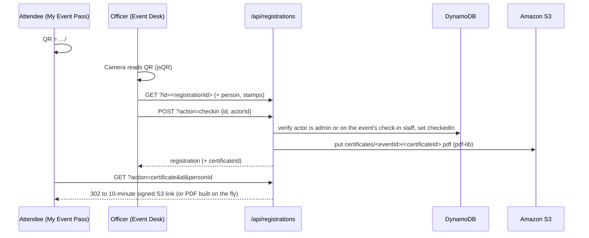
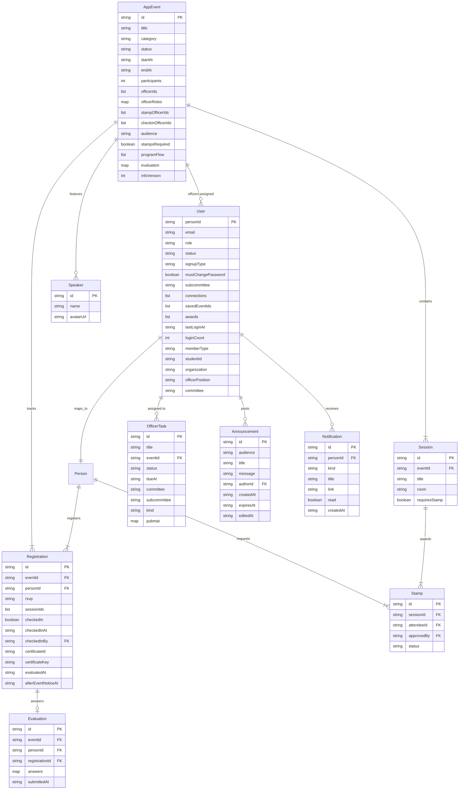

# AWS SBG-APC Event Tracker - System Architecture 📐

This document describes the architectural layout, data flow, component hierarchies, and design principles of the **AWS SBG-APC Event Tracker** application.

---

## 🏗️ High-Level System Architecture

```mermaid
graph TD
    User["📱💻 User (Attendee / Officer / Admin)"] --> Layout["AppLayout (Sidebar on laptops, Bottom Nav on phones)"]
    
    subgraph Presentation Layer
        Layout --> Dashboard["DashboardPage"]
        Layout --> Flow["EventFlowPage"]
        Layout --> Profile["ProfilePage"]
        Layout --> OfficerDash["OfficerDashboardPage"]
        OfficerDash --> Scanner["OfficerScanPage (camera QR check-in)"]
        Layout --> Pass["EventPassPage (QR pass, calendar, certificate)"]
        Layout --> Notifs["NotificationsPage (bell inbox)"]
        Layout --> Leader["LeaderboardPage (admin monitoring)"]
        Layout --> PersonPage["PersonProfilePage (/people/:id)"]
        AdminHome --> Tracker["ContentTracker (Marketing pubmats)"]
        Public["VerifyCertificatePage (public /verify/:id)"]
        Layout --> AdminHome["AdminHome (admin /home)"]
        AdminHome --> AdminDash["AdminDashboardPage (Manage Accounts)"]
        AdminHome --> AdminAtt["AdminAttendeesPage (Attendees & Stamps, Excel)"]
        AdminHome --> AdminOff["AdminOfficersPage (Officers, Archive)"]
        AdminHome --> AdminTasks["AdminTasksPage (Officer Tasks)"]
        Layout --> Builder["EventBuilderPage"]

        Dashboard --> StampCard["EventStampCard (Circle Stamp Passport)"]
        Flow --> StampCard
        Profile --> QRCard["NetworkingCard (Inline QR Code)"]
        Profile --> AvatarAdjuster["AvatarImageAdjuster (Circular Crop)"]
        Builder --> BannerAdjuster["ImageBannerAdjuster (16:9 Frame)"]
        Builder --> AvatarAdjuster
        Builder --> UploadShelf["RecentUploadsShelf (Recent Uploads Storage)"]
    end

    subgraph State Management Layer
        AuthCtx["AuthContext (User Session & Role)"]
        EventCtx["EventContext (Active Event Selection)"]
    end

    subgraph Client Service Layer
        AuthSvc["authService.ts"]
        EventSvc["eventService.ts"]
        SessionSvc["sessionService.ts"]
        StorageSvc["storageService.ts"]
        UploadStorageSvc["uploadStorageService.ts"]
        RegSvc["registrationService.ts"]
        TaskSvc["taskService.ts"]
        NotifySvc["notifyService.ts (emails)"]
        InAppSvc["notificationService.ts (bell)"]
        IDBStore[("Browser IndexedDB (Persistent File Storage)")]
        LocalStore[("Browser LocalStorage (Fallback)")]
    end

    subgraph Serverless API & AWS Cloud
        VercelAPI["Vercel Serverless Functions (/api/*)"]
        DynamoDB[("Amazon DynamoDB (single table: users, events, sessions, stamps, registrations, tasks, speakers, notifications, uploads)")]
        S3Bucket[("Amazon S3 (banners, avatars, certificate PDFs)")]
        SES[("Gmail SMTP / Amazon SES (Emails)")]
        Cron["Vercel Cron (daily 8:00 AM Manila)"]
    end

    Dashboard -.-> AuthCtx
    Dashboard -.-> EventCtx
    OfficerDash -.-> SessionSvc
    StampCard -.-> SessionSvc
    BannerAdjuster -.-> StorageSvc
    AvatarAdjuster -.-> StorageSvc

    EventSvc --> VercelAPI
    SessionSvc --> VercelAPI
    StorageSvc --> VercelAPI
    EventSvc -.-> LocalStore
    SessionSvc -.-> LocalStore
    AuthSvc --> VercelAPI
    AuthSvc -.-> LocalStore
    RegSvc --> VercelAPI
    TaskSvc --> VercelAPI
    NotifySvc --> VercelAPI
    InAppSvc --> VercelAPI
    InAppSvc -.-> LocalStore
    Scanner -.-> RegSvc
    Pass -.-> RegSvc
    Notifs -.-> InAppSvc
    Scanner -.-> SessionSvc
    Leader -.-> SessionSvc
    Public -.-> RegSvc
    AdminAtt -.-> RegSvc
    AdminTasks -.-> TaskSvc
    Cron --> VercelAPI
    VercelAPI --> SES

    VercelAPI --> DynamoDB
    VercelAPI -. Pre-signed URLs .-> S3Bucket
```

---

## 🧩 Architectural Layers

### 1. Presentation & Component Layer
- **`AppLayout.tsx`**: Main structural layout wrapper implementing:
  - Sticky mobile `AppBar` (`position="sticky"`, `borderRadius: 0`) with title truncation.
  - Inline collapsible menu (`Collapse`) for mobile navigation without backdrop overlays.
  - Laptop permanent sidebar `Drawer` from the `md` breakpoint (768px; set in `theme.ts`).
  - Fixed `BottomNav` bar on phones (below 768px).
  - Page content centered with `maxWidth: 1280`.
- **Admin pages** (`AdminHome`, `AdminDashboardPage`, `AdminAttendeesPage`, `AdminOfficersPage`, `AdminTasksPage`) share `AdminUi.tsx` (header with back link, stat tiles, empty states, date formatting).
- **`EventStampCard.tsx`**: Self-contained component that computes event session stamp slots dynamically:
  - Reads active event sessions and attendee stamp status.
  - Renders grid of circular slots representing each workshop/session.
  - Handles one-tap stamp requests and displays approval state transitions (`approved`, `pending`, `unclaimed`).
- **`ImageBannerAdjuster.tsx`**: 16:9 interactive banner frame editor with zoom, pan, and 1280×720 export matching preview.
- **`AvatarImageAdjuster.tsx`**: Circular avatar cropper with circular mask preview and pan/zoom controls for attendees and speakers.
- **`NetworkingCard.tsx`**: Inline, non-overlay profile card generating external QR code images using QR Server API.

### 2. State Management Layer
- **`AuthContext.tsx`**:
  - Manages active user session (`User | null`).
  - Handles `login`, `logout` and `setCurrentUser` (after profile changes).
  - Persists the signed-in user in `localStorage` under `aws-event-tracker.user` and refreshes it from the server on startup (so role changes and approvals apply).
- **`EventContext.tsx`**:
  - Maintains currently selected active event (`AppEvent | null`).
  - Persists event context in `localStorage` under `aws-event-tracker.selectedEvent` and refreshes it on startup.

### 3. Service, Serverless & Cloud Storage Layer
- **`sessionService.ts`**: Handles session lookup, stamp creation (`createStamp`), stamp approvals (`approveStamp`), and declines (`declineStamp`). Connects to `/api/stamps` and `/api/sessions` with local fallback.
- **`eventService.ts`**: Handles event CRUD operations, connecting to `/api/events` with local fallback.
- **`storageService.ts`**: Requests S3 pre-signed upload URLs from `/api/upload-url` and streams cropped images directly to Amazon S3.
- **`api/` (Vercel Functions)**: Self-contained serverless microservices connecting to AWS SDK v3 DynamoDB client (`@aws-sdk/client-dynamodb`, `@aws-sdk/lib-dynamodb`) and S3 client (`@aws-sdk/client-s3`).
- **`authService.ts`**: Sign up, sign in, approval (`approveUser` / `rejectUser`), profile and role updates and password changes through `/api/users` (scrypt-hashed passwords), with a `localStorage` fallback.
- **`notifyService.ts` → `/api/notify`**: Email notifications through Amazon SES (account approved/declined, event assignment, new task) and a daily Vercel Cron job (8:00 AM Manila) for event and task reminders.
- **`registrationService.ts` / `taskService.ts` / `speakerService.ts`**: Registrations and check-in, officer tasks, and the speaker directory through `/api/registrations`, `/api/tasks` and `/api/speakers`, with `localStorage` fallback (`apiClient.ts`).
- **`seedData.ts`**: Initial events/sessions used by the local fallback.
- **`notificationService.ts` → `/api/notifications`**: In-app inbox (`entityType = 'notification'`: `personId`, `kind`, `title`, `message`, `link`, `read`). Created by the page that performed the action (stamp review, account review, assignment, task, check-in, sign-up → every admin via `toRole: 'admin'`). The bell badge (`useUnreadNotifications`) refreshes on changes, window focus and every 30 s.
- **Check-in & certificates (`/api/registrations?action=checkin|checkout|certificate`)**: the QR pass encodes `…/#/officer/scan?pass=<registrationId>`. Check-in requires an admin `actorId`, or an officer listed in the event's `checkinOfficerIds`, sets `checkedIn/checkedInAt/checkedInBy`, and reserves a unique certificate code (checked against existing codes). **The certificate unlocks only after the event's `endAt`, and only for checked-in registrations**: `GET ?action=certificate&id=&personId=` (owner / check-in staff) or `&certificateId=<code>` (anyone with the link), `&download=1` for an attachment instead of inline. The first open after the event dates it to the event's end and stores the PDF (`pdf-lib` → `s3://$AWS_S3_BUCKET_NAME/certificates/<eventId>/<code>.pdf`), served through a 10-minute signed link; with no bucket, or if the upload fails, the PDF is generated on the fly. `action=verify` returns `valid`, `not-yet`, `revoked` or `not-found`. The daily run posts a "certificate ready" bell notice and email to everyone checked in, once per event, for events that ended in the last week.
- **`utils/calendar.ts`**: RFC 5545 `.ics` builder (UTC times, escaping, line folding, 1-hour alarm) and Google Calendar `TEMPLATE` links with `ctz=Asia/Manila`.

### 4. Notifications - email (Gmail SMTP / Amazon SES) and in-app

Emails go through Amazon SES (domain `apcsbg.org`, sender `SES_FROM_EMAIL` or by default `notifications@apcsbg.org`, region `ap-southeast-1`) or Gmail SMTP. `EMAIL_PROVIDER` chooses (`ses`, the default, or `gmail`); a rejected SES send is not retried through Gmail. SES uses its own send-only keys (`SES_ACCESS_KEY_ID` / `SES_SECRET_ACCESS_KEY`) when set, else `APP_AWS_*`. Every email is CC'd to a fixed list of club addresses in `sendMail()` plus `NOTIFICATION_CC_EMAILS`, except mails marked `noCc` (password codes). Links in emails use `APP_URL`, else the request's host (`http` for localhost, otherwise `x-forwarded-proto` or `https`). The app is served on the custom domain `https://apcsbg.org` (Vercel); `APP_URL` sets the links in emails. In-app notifications (the bell) are written by the page that performed the action:

| In-app notification | Recipient | Created by |
| :--- | :--- | :--- |
| New sign-up waiting | Every admin (`toRole: 'admin'`) | Sign-up page |
| Account approved / declined (with reason) | The person | Manage Accounts |
| Assigned to an event | That officer | Event page (admin) |
| New task | Assigned officers | Officer Tasks |
| Stamp approved / declined | The attendee | Officer Dashboard |
| Checked in (certificate ready) | The attendee | Event Desk |
| Announcement (officers or everyone) | Its audience | `api/notifications.ts` (`action=announce`) |
| Answer the evaluation / certificate ready | Each checked-in attendee, once, after the event | `api/notify.ts` (`after-event`, daily cron) |
| Certificate ready after answering | The attendee | `api/registrations.ts` (`action=evaluate`) |

Emails:
| Trigger | Recipients | Sent by |
| :--- | :--- | :--- |
| New sign-up waiting | Admin inbox (`ADMIN_NOTIFY_EMAIL`, default `aws.apcofficial@gmail.com`) | Sign-up page → `/api/notify` |
| Account approved / declined (with reason) | The person | Manage Accounts → `/api/notify` |
| Officer assigned to an event | That officer (APC + personal email) | Event page → `/api/notify` |
| New task | Assigned officers | Officer Tasks → `/api/notify` |
| Event tomorrow / "See you today" | Registered attendees + assigned officers | Daily Vercel Cron → `/api/notify` |
| Task due tomorrow | Assigned officers | Daily Vercel Cron |
| Answer the evaluation to get your certificate / certificate ready | Checked-in attendees, once per event | After-event run (app load, max every 5 min) + daily Vercel Cron |
| Failed reminders / daily job error | Admin inbox | Daily Vercel Cron |

Each reminder is sent once (flags stored on the event/task); moving an event's date re-arms its reminders. Without Gmail or `SES_FROM_EMAIL` settings, no email is sent and the app says so (in-app notifications still work).

### 5. QR check-in & certificates

- **Event staff (who may do what)**: each event stores `officerIds` + `officerRoles` and two duty lists, `stampOfficerIds` and `checkinOfficerIds`. Only an admin changes them, through `PUT /api/events?id=…&action=staff`; ordinary event edits keep the lists and prune anyone no longer assigned. `/api/stamps` (approve / decline) and `/api/registrations` (check-in / undo / opening someone else's certificate) look up the actor and allow admins, or officers on the matching list for **that** event. New stamps are always `pending`; a plain registration `PUT` can't set `checkedIn`. The client mirrors the rule in `utils/eventStaff.ts` (`canDo`) to hide what an officer can't do. A third list, `foodOfficerIds` (duty `food`), is the **food team**.
- **Food stubs** (`event.food = { enabled, meals: [{ id, label, opensAt? }] }`, cleaned in `pruneStaff`, edited with `FoodStubsEditor`): `GET /api/registrations?action=meals&eventId&actorId[&personId]` returns one person's stubs (themselves or staff) or, for the food team / admins, everyone who gets food (`foodPeople()`: checked-in attendees, `officerIds` and duty lists, speakers with `personId`; admins excluded) and all claims. `POST ?action=meal` (`requireFoodStaff`) checks the meal is open and the person qualifies, then writes `entityType: 'mealclaim'`, id `meal-<eventId>-<personId>-<mealId>`, with `ConditionExpression: attribute_not_exists(id)`; a repeat returns `alreadyClaimed` with the first claim. `action=meal-undo` deletes it. Client: `services/foodService.ts`, `components/FoodDesk.tsx` (`ScanFoodSection` on the scan card, `FoodDeskPanel` as the desk's Food tab), `components/FoodStubsCard.tsx` (pass and event page).
- **Event Desk** (`OfficerScanPage` + `StampRequestsPanel` + `EventAttendeesPanel`): for the selected event it loads registrations, sessions and that event's stamps, refreshing every 20 s; the sidebar badge comes from `useDeskCounts` (pending stamps at events where the user may approve). `PUT /api/stamps` only approves when the attendee has a checked-in registration for the session's event (`409 NOT_CHECKED_IN` otherwise), so *Check in & approve* calls check-in first, then approve.
- **Registrations**: `rsvp` is the status - `pending` (new), `approved`, `declined`; older `going`/`interested` are read as approved/pending. Only admins and the event's check-in team change it (`PUT ?id=` with `actorId`, or `POST ?action=review` in bulk); check-in sets `approved`; `DELETE` refuses checked-in registrations.
- **Sessions**: `POST/PUT/DELETE /api/sessions` require an admin `actorId` and keep only session fields; the event page's **SessionEditor** uses them.
- **Pictures**: `/api/upload-url` returns `/api/uploads?action=image&key=events/…`, which redirects to a 1-hour signed S3 link (works with a private bucket). `utils/imageUrl.ts` rewrites older public S3 links the same way when events, speakers and people are loaded.
- **App tour** (`TutorialTour`, `utils/tourSteps.ts`): steps per role point at elements marked `data-tour="…"`; the first visible one is highlighted (sidebar or bottom bar). Finishing or skipping sets `tutorialSeen` on the account.
- **Session picks**: `registration.sessionIds` holds the sessions a registered attendee plans to attend; only they can change it (`PUT /api/registrations?id=` with their `personId`), and the server keeps only that event's sessions. `useSessionPicks` turns an event's registrations into per-session "going" counts (people who declined are skipped). The event's `participants` stays the single expected number for the whole event; events may have no sessions.
- **Stamps at the booth**: the scanner lists the event's stamp sessions (live ones first). *Give stamp* reuses `sessionService` - it creates the stamp if the attendee never requested it, then approves it with the officer's id - and notifies the attendee. *Remove stamp* (scan card or the *Stamps given* list) calls the same stamp DELETE that declines a request; the server lets only the event's stamp team or admins do it, and the attendee is notified.
- **Verification**: every certificate carries a QR code to `…/#/verify/<certificateId>` (built from `APP_URL` or the request host). `GET /api/registrations?action=verify&certificateId=` is public and returns only what is printed on the certificate (name, event, dates, venue, issue date) plus `valid` / `revoked` / `not-found`.
- **Password codes**: `POST /api/notify { type: 'password-code', personId | login }` makes a 6-digit code (`crypto.randomInt`), stores only `sha256(salt:code)` on the account as `pwCode { purpose: change | reset, salt, hash, expiresAt (10 min), tries, sentAt }` plus `pwCodeSends` (1 a minute, 5 an hour), and emails it in the body only (no subject, no link, **no CC copies**: `Mail.noCc`). `login` requests answer the same whether or not the account exists. `POST /api/users?action=password { id, currentPassword, code, newPassword }` and `action=reset-with-code { login, code, newPassword }` check the code (`checkCode`, constant-time, purpose must match, 5 tries, then it's discarded) and clear it on success. Login counts `failedLogins` and sets `lockedUntil` (15 min) after 5 in a row; success or a reset clears them. `sanitize()` never returns `passwordHash`, `pwCode`, `failedLogins` or `lockedUntil`. UI: `ChangePasswordForm` (two steps), `ForgotPasswordDialog` (sign-in page), `ForgotPasswordPage` (`/forgot-password`; `/reset-password` from older emails shows the same page), `VerificationCodeField` (digits only, `autocomplete=off`). Sign-in and reset accept the APC email, personal email or username. Older `resetCode` / `resetToken` fields are never returned and are cleared on the next change. Local mode (no API) shows the code on screen since there's no email.
- **Accounts**: passwords need 6+ characters with upper, lower, number and symbol (`utils/people.ts` `PASSWORD_RULES`, mirrored in `api/users.ts`). `POST /api/users?action=create` (admin) makes an approved account with `mustChangePassword: true`; `action=reset` (admin) sets a new temporary password; `action=password` (current password + emailed code) clears the flag. `ProtectedRoute` sends flagged accounts to `/change-password`. `savedEventIds` is a profile field the owner can edit. **Connections** are mutual and change only through `POST /api/users?action=connect|connect-respond|connect-cancel|disconnect` (`{ actorId, id, accept? }`): a request is stored as `connectionRequests` on the receiver and `sentConnectionRequests` on the sender; approving links both `connections` lists; a request crossing an existing one connects right away. The client (`connectionAction`, `components/ConnectButton.tsx`) sends `connection-request` / `connection-accepted` notifications. **Socials** (`socials`: linkedIn, github, twitterX, website, facebook, instagram, tiktok, youtube, `custom[]` of `{label,url}`, max 10) are cleaned by `cleanSocials()` in `api/users.ts` (no `javascript:`/`data:` links, 300-char cap); `utils/socials.tsx` lists the platforms for `SocialLinksEditor` / `SocialLinksRow`. **Speakers** may carry `personId` (linked account), `email` (auto-links when an account with it exists) and `socials`; `getSpeakersByIds()` adds the account's live `profile` (name, photo, socials, officer title) and `components/SpeakerItem.tsx` shows it. `api/seed.ts` also reports built-in Tech Barangay sessions attached to another event and moves them (`?action=fix-sessions`). **Adviser** (`role: 'adviser'`, admin-created): `components/AdviserHome.tsx` at `/home`; announcements (`entityType: 'announcement'`) and sign-off requests (`entityType: 'signoff'`, pending → approved / returned; `DELETE ?action=signoff` soft-deletes with `deletedAt` / `deletedBy` / `purgeAfter` (+30 days), admins any, senders their own; `POST ?action=signoff-restore` for admins or whoever deleted it) live behind `?action=` routes in `api/notifications.ts` (`services/adviserService.ts`, components `AnnouncementsCard`, `SignoffPanel`); admin-only APIs keep rejecting the adviser. **Task comments** (`comments[]`, `POST /api/tasks?action=comment`, admins, the people on the task and its committee leads) and `deadlineInfo()` in `types/task.ts`; the daily job (`runReminders` in `api/notify.ts`) posts bell notices + emails for tasks due tomorrow and overdue ones every 3 days (`dueReminderSentAt`, `overdueReminderAt`), and runs the in-app part even without email. **Co-organizer staff**: attendee accounts with `partnerOrg` (admin-only field, cleared if the role changes); `utils/eventStaff.ts` `canDo()` / `isPartnerStaff()` / `mayWorkEvents()` and the server checks in `api/stamps.ts` (`stampApprover`) and `api/registrations.ts` (`requireCheckinStaff`) accept them when they're on the event's duty lists. Events carry `coOrganizers` (≤ 5 names, cleaned in `pruneStaff`). **Officer-added tasks**: `POST /api/tasks?action=propose` (officer → `approval: 'pending'`, assigned to themselves) and `action=review` (admin → approved/declined + `reviewNote`); `PUT` refuses status changes while not approved; `isApprovedTask()` keeps unapproved tasks out of the leaderboard and badges. **Event Desk counts** (`hooks/useDeskCounts.ts`) are per event over non-cancelled events the user can stamp, refreshed on a `DESK_CHANGED` window event fired after desk actions. **Profile edits** (`PUT /api/users`) accept first/middle/last name (display name recomputed), student ID (APC, `^\d{4}-\d{6}$`, checked when changed; `utils/people.ts` `formatStudentId` / `isValidStudentId`, `components/StudentIdField.tsx`) or organization (outside), personal email, bio; admins can also change `email`. **Fix requests**: `POST /api/users?action=fix-request { actorId, id, fields, note }` (admin; `fields: []` cancels) stores `fixRequest`; a `PUT` that changes a requested value removes it from the list (`FIX_KEYS`), and an empty list clears it (`fixedAt`). UI: `components/AccountFixDialogs.tsx` (`EditAccountDialog`, `FixRequestDialog`), `components/FixRequestBanner.tsx` (in `AppLayout`), `/profile?edit=1` opens the editor; email type `fix-request` in `api/notify.ts`, notification kind `profile-fix`. **Link checks** (`utils/linkCheck.ts`, mirrored in `api/users.ts`, `api/speakers.ts`, `api/notifications.ts`): `socialLinkError()` (platform links must be on the platform's domain) and `documentKind()` (sign-off links only from Google, Canva or Microsoft, saved as `linkKind`); sign-off senders: `canRequestSignoff()` in `utils/people.ts`. **Forgot password** also emails a notice without the code to `PASSWORD_RESET_NOTIFY` (`resetNotice` in `api/notify.ts`). **Undo check-in** at the desk uses `undoCheckIn` (`action=checkout`). **About** window: `components/AboutDialog.tsx`, version in `src/version.ts`. **Logos** live in `public/brand/` (the round club badge `sbg-apc-badge.webp`, with the icons below made from it, `icon-192.png` / `icon-64.png`, `apple-touch-icon.png`, `apc-logo.png`) plus `public/favicon.png`; paths are in `src/brandAssets.ts` (`LOGOS`). The app's own mark (bolt on the brand gradient) is `components/AppMark.tsx`, used beside the app name in the footer band. The club's social links are `SITE.socials` (shown by `components/ClubSocials.tsx`). **Site info** (`src/siteInfo.ts`: contact email, club website, project credit (*A project by …*), `termsVersion`; `mailTo()`, `problemReportLink()`) feeds `components/FooterBand.tsx` (animated footer on Get Started / `WelcomePage`) and `components/SiteFooter.tsx` (login, sign-up, About, legal pages) and `pages/LegalPage.tsx` (`/privacy`, `/terms`, public routes). Sign-up requires `acceptedTerms: true` (`api/users.ts`, `TERMS_VERSION`) and stores `termsAcceptedAt` / `termsVersion` on the account. **Password fields** use `components/PasswordField.tsx` (own show / hide button; Edge's `::-ms-reveal` is hidden in the theme). **Story card**: `utils/storyCard.ts` draws the card on a canvas (`drawStory(ctx, data, t)`, `t` 0..1 for the opening animation; `storyHashtags`, `storyCaption`); `components/StampStoryDialog.tsx` (`ShareStampsButton`, shown with at least one approved stamp) previews it, shares it with the Web Share API (files) or downloads a PNG. Photos from other sites are loaded with CORS and skipped if they can't be, so the download never fails; a photo picked in the dialog stays in the browser. Stamp passports (`EventStampCard` with an `event` prop and `hideWhenEmpty`) render on the Dashboard and event page for live/upcoming registered events with stamps; Achievements shows only completed items and certificates.
- **Tasks & pubmats** (`api/tasks.ts`): tasks carry `committee`, `subcommittee` and a deadline; `kind: 'pubmat'` items carry a `pubmat` object (designee / caption writer / poster ids, stage, post date, http(s) file link, notes) and appear in the Marketing **Content Tracker**. `assigneeIds` is everyone on the pubmat so the Officer Dashboard, notifications and the daily due reminders work unchanged. **Who may change tasks** (`utils/taskScope.ts`, mirrored in `api/tasks.ts`): `taskScope(user)` is `'all'` (admin, President), a committee list (`VP_COMMITTEES`: VP External = Marketing, Relations, Technicals; VP Internal = Operations, Secretariat, Technicals) or `[committee]` (Director, Assistant Director), else `null`. `POST` needs a creator with a scope (assignees must be approved officers in it; a lead with several committees must pick one; pubmats need Marketing); `PUT` needs `actorId` and allows leads in scope (`taskInScope`: by committee, pubmats are Marketing) or the people on the task (status and pubmat progress only); `DELETE ?id=&actorId=` allows leads in scope or the officer's own unapproved request; leads edit tasks with `components/TaskEditDialog.tsx` (title and at least one officer required, an empty `eventId` makes it whole org, a changed `dueAt` clears `dueReminderSentAt` / `overdueReminderAt`); `action=review` checks the proposer's committee. Leads' own `action=propose` tasks are approved at once. The page is `AdminTasksPage` at `/admin/tasks` (admin) and `/officer/tasks` (leads), filtered with `canAssignTo` / `taskInScope` / `proposalInScope`. A task with no `eventId` is a **whole-org** task (form toggle *Whole org / An event*; board filter `matchesEventFilter`). **Views** (`components/TaskSummaryTables.tsx`): Cards, a sortable `TaskTable` and an `OfficerSummaryTable`; rows and counts come from `utils/taskSummary.ts` (`taskRows`, `officerSummary`, `committeeSummary`), which also feed **Download Excel** (`downloadExcel`: sheets Tasks, By officer, By committee) from the same filtered list.
- **Events**: `eventService` applies `liveStatus()` (`utils/eventStatus.ts`) so ended events are *accomplished* (Past) and running ones *ongoing*, regardless of the stored status. `GET /api/seed` lists built-in club events missing from DynamoDB; `POST /api/seed` (admin) adds only those.
- **Leaderboard** (`utils/leaderboard.ts`, `utils/badges.ts`, data from `useBoardData`): two boards ranked by achievement points, listing everyone with an approved account (0 points included; admins excluded). *Attendees* (all non-admins, so officers appear too): 10 per approved stamp (one per person and session), +5 for workshops (session `type: 'workshop'`), 15 per check-in, 20 per badge. *Officers*: 5 per stamp approved (`approvedBy`), 5 per check-in done (`checkedInBy`), 20 per completed task, 25 per event volunteered (`officerIds`), 20 per officer badge (`utils/officerBadges.ts`: automatic ones from that work, *Event Host* from `officerRoles = host`, *Content Creator* from a posted pubmat, plus admin-awarded ones stored in `user.awards` via `POST /api/users?action=award|unaward`). Equal points share a rank. With an event filter only that event counts and badge points are left out; badges are always computed from all events. The leaderboard is admin-only; attendees and officers see their own stats and badges on the Achievements page (`MyStandingCard`).

---

## 🎨 Responsive & "No-Overlays" Design Principles

1. **Inline Flow over Modal Popups**:
   - Replaced `<Dialog>` and full-screen backdrop modals with inline `<Card>` and `<Collapse>` elements.
   - Eliminates z-index conflicts, focus-trap bugs, and dark backdrop screens on mobile devices.

2. **Edge-to-Edge Header & Bottom Bar**:
   - Navigation header uses `position="sticky"` with `borderRadius: 0` to prevent floating card overlays.
   - Bottom navigation bar (`BottomNav`) is fixed at `bottom: 0` with `zIndex: 1200` and padded content offset (`pb: 10`).

3. **Responsive Layouts (phone & laptop)**:
   - Breakpoints (`theme.ts`): `sm` 600, `md` 768 (sidebar layout), `lg` 1100, `xl` 1536.
   - Phones: one column. Laptops: CSS grids with 2–3 columns (event picker, admin lists), side-by-side sections (Profile, Connect, Officer Dashboard, Officer Tasks), and a two-column Welcome page.

---

### 6. Event info, announcements, saved copy, evaluation, sharing and registration links (v0.6.16 - v0.6.27)

- **Official event info** (`src/data/clubEventInfo.ts`, mirrored in `api/seed.ts` as `CLUB_EVENT_INFO` with a `version`): `GET /api/seed` lists events whose `infoVersion` is older (`outdatedEvents`); Admin Home's **Update them** calls `POST /api/seed?action=update-events` (admin), which fills descriptions, dates, venues, co-organizers, participants, `programFlow` rows and speakers, keeping pictures and staff lists. Events carry `programFlow` (`{time, duration, activity, personInCharge}[]`, max 60 rows, cleaned in `pruneStaff`), shown by `ProgramFlowTable` and edited by `ProgramFlowEditor` (paste from a document → `parseProgramFlow`).
- **Officers-only events**: `audience: 'officers'`. Everyone sees them; `POST /api/registrations` refuses attendees; the event page hides the participant count and explains why.
- **Pinned announcements** (`entityType: 'announcement'`, `api/notifications.ts`): `POST ?action=announce` stores `audience` (`officers`, or `everyone` for admins) and `expiresAt` (24 hours); `GET ?action=announcements` gives staff everything and members only `everyone`; `PUT ?action=announcement-edit` (author or admin). The bell notifications go out with `BatchWriteCommand` (25 per request, 4 at a time). `AnnouncementBanner` (top of every dashboard) shows the pinned ones with Edit / Remove; `AnnouncementsCard` posts and lists the earlier ones. Both reload on the `ANNOUNCEMENTS_CHANGED` window event.
- **Saved copy when the database is down** (`services/apiClient.ts`): GET responses are kept in `localStorage` (`aws-event-tracker.cache.v1:<url>`, up to 1.5 MB each). `cachedGet()` and `apiJson()` return the saved copy on a network error or a 5xx, and fire `OFFLINE_EVENT`, which `OfflineNotice` turns into a banner. Writes are never faked: they show the error. `isRemoteAvailable()` treats any JSON answer except 503 as "the API exists". `clearSavedCopies()` runs on sign-out.
- **Sign-in tracking**: login saves `lastLoginAt` and `loginCount` and returns `firstSignIn` (no earlier sign-in, tour not seen, account under 14 days old). `TutorialTour` only offers the tour when `firstSignIn` is set; Admin Home shows "Last signed in ...".
- **Pictures**: every avatar goes through `imageSrc()` (private S3 links → `/api/uploads?action=image`). If the S3 upload fails, the profile photo is saved as a small JPEG data URL (≤ 120 KB, 480 px) on the account.
- **Event evaluation** (`types/evaluation.ts`, `utils/evaluation.ts`, mirrored in `api/registrations.ts` and `api/notify.ts`): the event's `evaluation` (`{enabled, questions[]}`; missing = the standard questions, without the speakers question when the event has no speakers) is cleaned in `pruneStaff` (≤ 25 questions; types `rating` 1-5, `yesno`, `choice` with 2-10 options, `text`). Routes on `/api/registrations`: `GET ?action=evaluation&eventId&personId`, `POST ?action=evaluate` (registered + checked in, opens 30 minutes before `endAt`, once, answers validated) which saves `entityType: 'evaluation'` (`id: evl-<registrationId>`) and sets `registration.evaluatedAt` (the normal `PUT` can't set it), and `GET ?action=evaluations&eventId&actorId` (admin, adviser, the event's officers). **Certificates** (`action=certificate`, `action=verify`, and `certificateState()` on the client) need `evaluatedAt` when the evaluation is required: enabled and the event ends on or after `EVAL_REQUIRED_FROM` (2026-10-20), so older events keep their certificates. UI: `CertificateButton` (prompt + `EvaluationDialog`, re-checks every 30 s, `?evaluate=1` opens the form), Dashboard alerts, `EvaluationEditor` in the event form, `EvaluationResults` (averages, counts, written answers, who's missing, CSV) on the event page.
- **After-event notices** (`afterEventNotices` in `api/notify.ts`): for events that ended in the last 7 days, each checked-in registration gets one bell + email, "answer the evaluation" (kind `evaluation`, link `/events/<id>?evaluate=1`) or "certificate ready", marked with `afterEventNoticeAt` so a run cut short (8-second budget) continues without duplicates; the event gets `remindersSent.certificates` when everyone is done. It runs from the daily cron and from `POST /api/notify {type:'after-event'}`, which every signed-in app load calls (`nudgeAfterEventNotices`, once per 10 minutes per tab) and the server limits to once per 5 minutes (`sys-after-event-sweep` record). Answering after the event posts "certificate ready" right away.
- **Registration link**: `api/events.ts` sets `externalUrl` to `<app>/api/events?action=share&id=<id>&register=1` on create and update, and adds it to every GET. With `register=1` the share page says "Register: ..." and redirects to `/#/e/<id>?register=1`; `EventPreviewPage` passes it through sign-in (`LoginPage` keeps `from.search`) or remembers it on sign-up (`utils/registerIntent.ts`, used on the first sign-in to `/home`); `EventDetailPage` shows the one-tap **Register** box for `?register=1`. `RegistrationLinkCard` (admin; event page and event form) shows the link, Copy and a 1024 px QR PNG (`qrcode`).
- **All stamps for the certificate**: `stampProgress()` in `api/registrations.ts` (and in `utils/evaluation.ts` / `api/notify.ts`) counts the event's `requiresStamp` sessions against the person's approved stamps, for events ending from `EVAL_REQUIRED_FROM` unless `event.stampsRequired === false`. Missing stamps → `409 NEEDS_STAMPS` on the certificate, `not-yet` + `needsStamps` on verify, no "certificate ready" after the evaluation, and the after-event notice lists them. `certificateState()` has a `needs-stamps` state; `CertificateButton` shows the progress note; `notifyCheckedIn()` writes the check-in notification with the stamp list.
- **Who attends**: `POST /api/registrations` refuses admins and the adviser (they monitor). `ProgramFlowTable` hides *Person-in-charge* unless `showPersonInCharge` (officers, admins, adviser).
- **Sharing** (`components/ShareEventButton.tsx`): the link is `/api/events?action=share&id=<event>` when the API is live, an HTML page with Open Graph tags (title, date, venue, description, picture through `/api/uploads?action=image`) that redirects to `/#/e/<event>`. `EventPreviewPage` (public route) shows the event to signed-out visitors with Sign in (returns to `/events/<id>`) / Create an account, and sends signed-in people to the event page. The link is worked out when the button mounts so `navigator.share` runs directly in the tap (phones refuse it after an await); laptops get Copy link / Facebook / email, with a read-only link box when the clipboard is blocked. The button is on the event page and on each card in the events list.
- **Speakers lineup admin**: `SpeakerEditDialog` (`PUT /api/speakers?id=`) edits a speaker from the event page; *Remove from event* drops the id from `event.speakerIds` and from every session of the event (`updateSession`), since the lineup also shows session speakers.

---

### 7. API reference (12 Vercel functions, Hobby plan limit)

Extra features are `?action=` routes inside the existing files, so the function count stays at 12. Write routes check the acting account (`actorId`) on the server; see ADR-008 for the limits of that.

| File | Routes |
| :--- | :--- |
| `api/users.ts` | `GET` all / `?id=`; `POST ?action=signup \| login \| password \| reset-with-code \| create \| reset \| connect \| connect-respond \| connect-cancel \| disconnect \| award \| unaward`; `PUT ?id=` (profile / admin changes); `DELETE ?id=&actorId=` (admin) |
| `api/events.ts` | `GET` all / `?id=` (each with its `externalUrl` registration link); `GET ?action=share&id=[&register=1]` (HTML link preview → app); `POST`; `PUT ?id=`; `PUT ?id=&action=staff` (admin: officers, roles, stamp / check-in duty lists); `DELETE` |
| `api/sessions.ts` | `GET [?eventId=]`; `POST` / `PUT ?id=` / `DELETE ?id=` (admin) |
| `api/stamps.ts` | `GET [?attendeeId=&sessionId=]`; `POST` (always pending); `PUT ?id=` approve / decline (admin or the event's stamp team, attendee must be checked in); `DELETE` |
| `api/registrations.ts` | `GET [?eventId=&personId=&id=]`; `POST` (pending; not for admins / adviser; officers-only events); `POST ?action=review \| checkin \| checkout`; `PUT ?id=` (status by staff, session picks by the attendee); `DELETE`; `GET ?action=certificate \| verify \| evaluation \| evaluations \| meals`; `POST ?action=evaluate \| meal \| meal-undo` |
| `api/tasks.ts` | `GET [?assigneeId=&eventId=]`; `POST` (`createdBy` with a task scope); `POST ?action=comment \| propose \| review`; `PUT ?id=` (`actorId`); `DELETE ?id=&actorId=` |
| `api/notifications.ts` | `GET ?personId=`; `POST`; `PUT ?id=` / `?personId=&all=1` (read); `DELETE ?id=`; `GET ?action=announcements \| signoffs`; `POST ?action=announce \| signoff \| signoff-review`; `PUT ?action=announcement-edit`; `DELETE ?action=announcement` |
| `api/notify.ts` | `GET` (daily Vercel Cron, `CRON_SECRET`); `POST { type: account-reviewed \| event-assigned \| task-assigned \| signup-pending \| run-reminders \| after-event \| password-code }` |
| `api/speakers.ts` | `GET`; `POST`; `PUT ?id=` |
| `api/seed.ts` | `GET` (missing / outdated club events); `POST` (admin: add missing); `POST ?action=update-events \| fix-sessions` (admin) |
| `api/upload-url.ts` | `POST` → pre-signed S3 upload URL |
| `api/uploads.ts` | `GET ?action=image&key=events/...` (redirect to a signed S3 link); `GET` / `POST` / `DELETE` recent uploads |

### 8. Screens and components not described above

- **Accounts**: `ForgotPasswordPage`, `VerificationCodeField`, `AddAccountPanel` (admin creates accounts with a temporary password; `OfficerRoleFields` for position / committee), `ChangePasswordPage` + `ChangePasswordForm` + `PasswordChecklist` (forced first change and Profile).
- **Officer work**: `MyDutiesCard` (co-organizer staff and officers: their duties per event), `EventDutyCard` (your access on the event page), `RegistrationRequestsPanel` (approve / decline registrations), `TaskRequestsPanel` (admin reviews officer-added tasks), `TaskThread` (task comments + `DeadlineChip`).
- **Attendees**: `InlinePass` (QR pass on the event page), `EventChips`, `utils/eventDisplay.ts` (tag colors and labels), `hooks/useSavedEvents.ts` (bookmarks), `EventOrganizerLogo`.
- **Legacy, not routed**: `pages/EventFormPage.tsx`, `pages/EventListPage.tsx`, `pages/MyRegistrationsPage.tsx` and `components/EngagementScoreCard.tsx` are kept only for older unit tests; the app uses `EventBuilderPage`, `EventsPage` and the event pass instead.
- **Local dev API** (`vite.config.ts` → `apiDevServer`): serves `/api/<name>` from `api/<name>.ts` through `server.ssrLoadModule`, with Vercel-style `req.query` / `req.body` and `res.status().json() / send()`; loads `.env.local` and Vite env into `process.env`; returns 503 when AWS keys are missing so the app falls back to `localStorage`.

---

## 🗄️ Entity Relationship Diagram (ERD)

---

## 🔒 Security & Access Control (RBAC)

| Role | Permissions |
| :--- | :--- |
| **public (signed out)** | Welcome, sign-in, sign-up, **forgot password** (`/forgot-password`, emailed code), **certificate verification** (`/verify/:id`) and **shared event pages** (`/e/:id`, `/api/events?action=share`). |
| **any signed-in account with a temporary password** | Only **Set your own password** (`/change-password`) until it's changed. |
| **`attendee`** | Register for events (admins and the adviser can't), view schedule, request stamps, edit personal bio/socials, view own stamp card, show the QR event pass, add events to a calendar, answer the event evaluation (opens 30 minutes before the end) and download own certificate after check-in, every stamp of the event (when it has stamp sessions) and the evaluation, share events, read own notifications, view the **leaderboard** and own badges. |
| **`officer`** | All attendee privileges + `OfficerDashboardPage`: see and complete assigned tasks, approve/decline stamp requests and check attendees in (in the **Event Desk**, `/officer/scan` - stamps only after check-in) **only at events where an admin put them on the staff list for that duty**, update their **Content Tracker** items (status, file link, notes). |
| **`adviser`** | View-only dashboard, post announcements to the officers, review sign-off requests, see evaluation results. |
| **`admin`** | All officer privileges + edit evaluation forms, see evaluation results, post announcements (officers or everyone) and edit them, approve/decline sign-ups (optional reason), change roles and delete accounts (`/admin`), monitor attendees and stamp finishers with Excel export (`/admin/attendees`), officer achievements, archive batches (`/admin/officers`), assign officer tasks (`/admin/tasks`), edit events, assign officers and set the **event staff list** (who can approve stamps / check in), **award officer badges**, send reminders. |

The built-in admin is `awsapc.admin` (password from `ADMIN_PASSWORD`). There are no demo accounts. Admin actions - and check-ins (`/api/registrations?action=checkin`, officer or admin) - are checked on the server against the acting account's role; the app does not yet use signed sessions (see ADR-008). A certificate can only be downloaded by its owner or by an officer/admin.

New accounts have `status: 'pending'` and cannot sign in until an admin approves them. Officer hierarchy: President → VP Internal → VP External → Directors → Assistant Directors → Associates; committees: Secretariat, Operations, Marketing, Technicals, Relations.

---

*Last Updated: October 2026*

### Check-in and stamp safety (v0.6.38)

- Stamps have one record per person per session: id `stp-<sessionId>-<attendeeId>`, written with `attribute_not_exists(id)`; approving uses `attribute_exists(id)` so a removed stamp isn't recreated. Staff removal also deletes older duplicates.
- Registration changes go through `patchRecord` in `api/registrations.ts`: read, change only the given fields, and write with a revision check (`rev`, conditional PutItem), retrying if someone saved in between. It needs only GetItem/PutItem, so the IAM policy in the README is enough. Check-in refuses when already checked in, so two scans at once check in once. Undo check-in sets that event's approved stamps back to pending (`stampsTakenBack`). A declined registration needs `confirmDeclined: true`.
- Every list read pages through the table with `LastEvaluatedKey` (one Scan page is at most 1 MB).
- Known limit (ADR-008): the server still trusts the `actorId` the app sends; signed sessions are planned.
